# Materials and shaders

A Mario Kart Wii material is a block inside an MDL0 plus a shared 512-byte "shader" block, and
between them they hold everything the GX hardware needs to draw a surface: which textures to
sample, how their coordinates are generated, how vertex colour and lighting feed in, the TEV
combiner program that mixes it all together, and the blend / depth / alpha-test state around it.

The feature is split in two. `src/lib/gxMaterial/` owns the bytes and the TEV semantics;
`src/ui/material/` owns the editor. `src/lib/gxMaterial/types.ts` is the contract between them —
plain JSON-serialisable data, no classes, so a material document can go in the undo history and
be diffed.

## Library

### File map

| File | What it does |
| --- | --- |
| `types.ts` | The contract: `GxMaterialDoc`, the shader graph, the compiler result, the presets. |
| `gxRegisters.ts` | GX display lists both ways: replay one into registers, emit one back byte-exactly. |
| `materialCodec.ts` | Material block and TEV block ⇄ `GxMaterialDoc`, plus the hardware-limit checks. |
| `archive.ts` | `listArchiveMaterials`, `decodeMaterial`, `applyMaterial`, `addTexture`, `removeTexture`, `renameTexture`. |
| `shaderGraph.ts` | `compileShaderGraph`: lowers a node graph to TEV stages. |
| `decompile.ts` | `decompileShader`: TEV stages back to a node graph, self-checked. |
| `defaults.ts` | `createDefaultMaterialDoc` and the pieces it is made of. |
| `presets.ts` | `SHADER_GRAPH_PRESETS`. |
| `index.ts` | The barrel the editor imports; nothing in `src/ui/` reaches past it. |

Everything is pure TypeScript. The only dependency outside `src/lib/` is the `GX` enum object from
`vendor/noclip.website/src/gx/gx_enum.ts`, which is a dependency-free file of constants.

### The MDL0 v11 material block

Version 11 is what every Mario Kart Wii course and object ships; the decoder refuses anything
else. Offsets are from the start of the block.

```
0x000  u32   block size
0x004  s32   distance back to the MDL0
0x008  s32   name (into the archive's string pool)
0x00C  u32   index in the Materials dictionary
0x010  u32   flags; bit 31 = draw in the translucent pass
0x014  u8    texgen count      0x015 u8 lighting channel count
0x016  u8    TEV stage count   0x017 u8 indirect stage count
0x018  u32   cull mode
0x01C  u8    zCompLoc          0x01D s8 light set   0x01E s8 fog set   0x01F pad
0x020  4xu8  indirect method   0x024 4xs8 normal-map light refs
0x028  u32   offset of the TEV block, relative to this block
0x02C  u32   layer count       0x030 u32 offset of the layer table
0x034  u32   fur data (v10+)   0x038 u32 user data (v11)   0x03C u32 display list offset
0x040        reserved; zero in all 8804 materials this editor has been run over
0x1A8  u32   texture SRT flags, four bits per layer
0x1AC  u32   texture matrix mode: 0 maya, 1 xsi, 2 max
0x1B0  8x14  texture SRTs: scale S/T, rotation, translate S/T
0x250  8x34  texture matrix effects: ref camera, ref light, map mode, misc, 3x4 matrix
0x3F0  2x14  lighting channels: flags, material colour, ambient colour, colour and alpha control
0x418  Nx34  the layer (sampler) table
       ...   padding to a 32-byte boundary
       0x180 the material display list
```

The layer table always starts at 0x418, so the display list starts at
`align(blockStart + 0x418 + layers * 0x34, 32) - blockStart` and the block is that plus 0x180.
The material block itself is only 4-byte aligned in retail files, which is why the display list's
offset depends on where the block sits.

The TEV block is a flat 512 bytes: size, distance back to the MDL0, its index in the Shaders
dictionary, the stage count, eight texture-reference bytes (`i` for each live layer, `0xFF` past
them), then a 480-byte display list at 0x20.

### Canonical display lists

Both lists are fixed-size and every write sits at a fixed offset. A BP write is
`0x61` + `u32(register << 24 | value)`; an XF write is `0x10` + `u16(count - 1)` + `u16(address)`
+ values. A BP write to register `0xFE` is a write mask that applies to the next write only.

Material list, 0x180 bytes:

```
0x00  BP F3 alpha function
0x05  BP 40 z mode
0x0A  BP FE mask 0x00FFE3   (dither and the colour/alpha update bits are left alone)
0x0F  BP 41 blend mode      0x14  BP 42 constant alpha
0x20  TEV colour register C0: RA once, then BG three times, five bytes apart
0x34  C1        0x48  C2
0x60  konst K0: RA then BG    0x6A K1   0x74 K2   0x7E K3   (bit 23 marks the konst bank)
0xA0  BP 25 / 0xA5 BP 26 indirect texture scales
0xAA  BP 06 / 07 / 08 indirect matrix 0
0xE0  per texgen i, 0x12 apart: XF 0x1040+i TexMtxInfo, then XF 0x1050+i PostMtxInfo
```

TEV list, 0x1E0 bytes:

```
0x00  eight (BP FE mask 0x0F, BP F6+n) pairs, 0x0A apart: the four swap tables
0x50  BP 27 indirect texture coordinate / texture map references
0x60  eight 0x30-byte stage pairs; pair k holds
        +0x00  BP FE mask 0xFFFFF0     +0x05  BP F6+k konst selections for both stages
        +0x0A  BP 28+k texture, coordinate and channel order for both stages
        +0x0F  colour env, even stage   +0x14  colour env, odd stage
        +0x19  alpha env, even stage    +0x1E  alpha env, odd stage
        +0x23  indirect command, even   +0x28  indirect command, odd
```

Swap tables and konst selections share registers F6..FD, which is why each write is preceded by
the mask that says which half of the register it owns.

### Byte-exact round trips

`decodeMaterial` followed by `applyMaterial` reproduces the archive byte for byte. That is checked
over every material in every archive the test fixtures find — 8804 materials in 371 course and
object archives on the development machine, and it passes on all of them.

Getting there needs one rule applied everywhere: **the encoder never builds a block from nothing.**
It copies the block it is replacing and patches the fields the document owns, and it starts each
display list from the one it is replacing rather than from zeroes. Everything the format has and
the editor does not model then survives untouched — and there is a surprising amount of it:

- The reserved 0x040..0x1A8 region, the texture-matrix effect matrices, and the data of channels,
  texgens and stages past the live counts.
- The emboss source and input form of a regular texgen, which no reader looks at.
- Fields that only mean something for a stage that does not exist: the unused half of an odd
  stage pair (parked on texmap 7 by some exporters, texmap 0 by others), the texture slot named
  by a stage that samples no texture, the low four bits of the konst register.
- Several encodings of the same thing. Attenuation "none" is stored both as zero and as
  spot-with-attenuation-off; some files leave junk in a channel control's high bits; the
  indirect-reference register's unused slots are `0x000000` in some tracks and `0xFFFFFF` in
  others. A control word is only rewritten when its stored form no longer means what the document
  says.
- Layout the exporter chose and this writer would not: an indirect matrix a file placed at a
  different offset, an indirect command slot given over to a different register entirely.

Two things follow from this. Byte-exactness is a property of *unchanged* fields, not of the
writer's canonical layout, so anything genuinely edited comes out in the canonical form above.
And the tests are the specification: a decoder that quietly dropped a field would show up as a
byte difference, which is the only assertion strong enough to prove the decoder is complete.

The suite also re-parses the result with the vendored noclip BRRES reader — the same code the
viewport uses, and an entirely independent implementation of the format — and checks that the
`GXMaterial` and sampler list it builds are unchanged.

### Writing back

`applyMaterial` works through `Mdl0Editor`, which never re-lays-out a model. Every pointer inside
an MDL0 is relative to the thing that holds it and is read back *unsigned*, so a block can only be
repointed at something that sits after it.

- **In place.** When the encoded block is the same size — which it is unless the layer count
  changed, since both display lists are fixed-size — the bytes are patched where they are.
- **Grown or shrunk.** The block is appended past the model's end, its Materials dictionary entry
  is repointed, and the old bytes are left as dead weight. BrawlBox does the same. The archive
  gains a few hundred bytes; every other offset in the file stays valid.
- **Shared shaders.** Materials commonly point at one TEV block. With `sharedShader: 'clone'`
  (the default) a changed shader is appended as a new 512-byte block, added to the Shaders
  dictionary under the editing material's name, and only that material is repointed at it — the
  block has to land after the material that names it, so it is appended second. With `'shared'`
  the block is overwritten in place; because the *stage count* lives in each material's header
  rather than in the shader, the materials sharing it have their count updated too, and they all
  appear in `affectedMaterials`.
- **Texture links.** The console binds textures by walking the MDL0's `Textures` section, not by
  name: a material missing from it renders untextured on hardware even though a name-resolving
  viewer shows it fine. `applyMaterial` rewrites exactly this material's `(material, sampler)`
  pairs, keeping foreign entries and unchanged pairs in place so an edit that changes nothing
  produces byte-identical link blocks.
- **Names.** A name lives in the archive's string pool, outside the model, and is pointed at
  relative to the field that holds it. Any block the editor writes declares its name pointers
  through `Mdl0Editor.addStringRef` so `writeBrres` can re-derive them. Renaming a material
  renames its dictionary entry and interns the new name; draw ops address materials by index, so
  nothing that draws it needs touching.
- **Draw pass.** Flipping `translucent` moves this material's draw ops between `DrawOpa` and
  `DrawXlu`, because the pass is a property of the bytecode list, not of the flag.

Adding or removing a `TEX0` is a container-level edit. A sub-file that changes position relative
to the string pool has to be able to re-derive its names, so a new texture is inserted right after
the models (which can) and ahead of the animation sub-files (which cannot), and a removed one
leaves its bytes behind as padding for whatever followed it so nothing moves at all.

`applyMaterial` refuses documents the hardware could not run — more than 8 textures or texgens,
16 stages, 4 indirect stages or 2 channels, out-of-range enums, a stage sampling a slot with no
layer — with a plain-English `GxMaterialError`. It refuses what *this edit* broke, though, not
what it inherited: retail tracks really do ship materials whose stage samples a texture slot they
have no layer for, and writing one of those back unchanged has to keep working.

### The shader graph compiler

A TEV stage computes, for colour and alpha independently,

```
out = clamp?( (d ± lerp(a, b, c) + bias) * scale )
```

and binds at most one texture, one texture coordinate, one rasterised channel and one konst
selection. Every node in the graph maps onto something a stage can do, so the compiler is a
lowering pass rather than a search.

Colour and alpha are compiled as two independent trees hanging off the output node, because the
hardware keeps two independent register sets. Lowering each is a post-order walk:

| Node | Stage form |
| --- | --- |
| `multiply(a, b)` | `A=ZERO B=a C=b D=ZERO` |
| `add(a, b)` | `A=b B=ZERO C=ZERO D=a` — with `c` zero the lerp is just `a`, so no konst is needed |
| `subtract(a, b)` | the same with `TevOp.SUB` |
| `lerp(a, b, t)` | `A=a B=b C=t D=ZERO` |
| `add`/`subtract` whose second input is a `lerp` or `multiply` used nowhere else | fused into one stage: `D` is the first input, `A/B/C` come from the fused node |
| `scale` | folded into the stage that produced its input when that stage still has the default bias and scale; otherwise a pass-through stage carries it |
| `compare` | `A/B/C/D` direct, bias `$HWB_COMPARE`, scale naming the comparison width |
| `texture` | binds the stage's texture and coordinate; `TEXC` or `TEXA` |
| `vertexColor` | binds the channel; `RASC` or `RASA` |
| `constant` | binds `konstColorSel` / `konstAlphaSel`; `KONST` |
| `register` | reads `C0..C2` (or `A0..A2`) as the register's *starting* colour |
| `value` | `ZERO` / `HALF` / `ONE`; the alpha input set has no half or one, so those come from a konst selection |
| `indirectWarp` | wired into a texture's UV input, it becomes that stage's `indTex*` fields |
| `rawStage` | copied out verbatim; its `prev` input only says what runs before it |

Intermediates live in the previous-stage register when the next stage reads them straight away.
When a sibling subtree is about to emit stages, or a value is read by more than one node, it is
spilled into one of C0..C2 with a copy stage and freed after its last use. The allocator never
takes a register some `register` node reads. Running out is an `error` diagnostic saying to split
the material or reuse a texture.

Zipping puts a colour op and an alpha op on the same stage when their texture, channel and
indirect bindings agree (konst is two separate fields, so it never conflicts). Where they
disagree, one side gets a pass-through — `d = PREV`, everything else zero — which leaves the other
pipeline's previous-stage register untouched. Pass-throughs count against the 16-stage limit.

`compileShaderGraph` never throws. Unwired inputs take the socket's `default` from
`GRAPH_NODE_SOCKETS`; nodes that cannot reach the output are `warning` diagnostics; a wire between
the colour and alpha pipelines, a cycle, a sampler the material does not have, and two textures on
one stage are `error` diagnostics, and an errored compile returns no stages. `usage` reports which
samplers, texture coordinates, channels, konst colours, registers and indirect stages the shader
actually touched, so the inspector can grey out the rest.

### The decompiler, and how it stays exact

`decompileShader` builds one cluster per stage, laid out left to right at `x = 260 * index` with
colour on the top row and alpha below. Each stage becomes an `add` (or `subtract`) fed by a
`lerp`, with a `scale` on top when the stage biases, scales or leaves its result unclamped. The
inputs become shared source nodes: one `texture` per (sampler, coordinate) pair, one
`vertexColor` per channel, one `constant` per konst selection, one `register` per register the
material starts with.

`compileShaderGraph(decompileShader(m), m).tevStages` equals `m.tevStages` for all 8804 fixture
materials. Two mechanisms get it there:

- **`stageTemplate`.** Every cluster node carries the original stage. Fields the graph has no
  opinion about — the konst selection a stage names even when it reads no konst, the raster
  channel it names when it reads no vertex colour, the swap tables, the indirect setup — are taken
  from it. Without this, roughly half of all retail stages would only round trip approximately.
- **`rawStage`.** Anything the node vocabulary genuinely cannot say becomes a read-only card
  holding the stage verbatim: an alpha value used as a colour input (`CC.RASA`, `CC.APREV`), a
  stage reading the previous-stage register before any stage wrote it, a comparison whose bias and
  scale the `scale` node would fight over. 1335 of 13608 fixture stages (9.8%) end up this way.

Which of the two applies is not guessed. `decompileShader` compiles what it built, compares it
against the material, pins the first stage that came back different as a raw stage and tries
again, and falls back to an all-raw chain if it ever stops making progress. So the round trip
holds by construction, and the raw-stage count is a measure of how much of a real material the
graph model captures rather than something that can silently drift.

The colour and alpha halves of one stage find each other again through a node-id convention:
`s3c`, `s3cl`, `s3cs`, `s3a`, `s3r` all belong to stage 3. Nodes the editor creates have their own
ids and no group, which is right — there is no original stage to line them up with.

### Adding a node type

1. Add it to `GraphNodeType`, give it an interface, add it to the `GraphNode` union and put its
   sockets in `GRAPH_NODE_SOCKETS` in `types.ts`.
2. Handle it in `Compiler.lowerNodeUncached` in `shaderGraph.ts`. If it computes something, build
   its operands with `lowerInput` and finish with `emitMath`, which takes care of binding
   conflicts, register allocation and stage placement. If it is a source, return an `Operand` with
   the right `CC`/`CA` input and whatever bindings it needs. Add it to `MATH_TYPES` if it emits a
   stage — that is what tells the spill logic a subtree will overwrite the previous-stage register.
3. Teach `decompile.ts` to emit it where it applies, if it has a stage shape to recognise.
4. Add a unit test in `shaderGraph.test.ts` for the shape it lowers to, and check the retail round
   trip still passes: it is the test that catches a node that quietly changes an existing lowering.

### Contract additions

`types.ts` was extended, backward compatibly, in four places:

- `GxSamplerDoc.tlutId?` — the palette slot a layer binds. A handful of retail layers use 1.
- `GraphNodeBase.stageTemplate?` — see above.
- `GraphConstantNode.colorSel?` / `alphaSel?` — the exact konst selection, for the cases `slot`
  cannot name: the eight hardware fractions and the single-channel reads (`K1[GGG]`).
- `'rawStage'` node type, with a `prev` input so a chain of them keeps its order.

`GxIndMatrixDoc.m` holds the effective coefficients (the 11-bit hardware values already multiplied
by `2 ** scaleExp`) and `scaleExp` is the hardware's 6-bit exponent field less its bias of 27, so
it runs -27..36. Both are exact.

## Editor

Material mode sits next to KMP / Camera / Model / Visual in the top bar. Like every other mode it
is a hook (`useMaterialMode` in `src/ui/material/MaterialMode.tsx`) that returns a `ModeUi`; the
shell composes it. KMP overlays are hidden while it is active, so the viewport shows what the game
would draw.

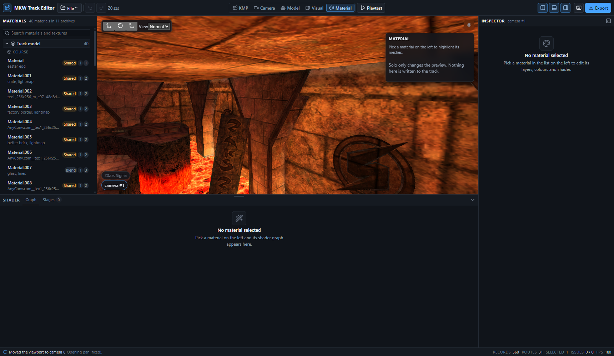

### Layout

| Region | What it is |
| --- | --- |
| Left dock | `MaterialOutliner` — the track's BRRES archives → models → materials. |
| Viewport | Unchanged, plus a top-right overlay with the selection, its mesh count and **Solo**. |
| Bottom dock | `ShaderGraphDock` replaces the content browser: **Graph** and **Stages** tabs. |
| Inspector | `MaterialInspector` — seven sections for the selected material. |

The bottom dock takes over the content browser's slot through `ModeUi.bottomDock`, a function the
shell calls with the dock's size, collapse flag and resize handlers (`ModeBottomDock` in
`src/ui/modes/types.ts`). The shell keeps owning that state, so the shader panel resizes and
collapses exactly like the browser and the browser comes back untouched when the mode is left.

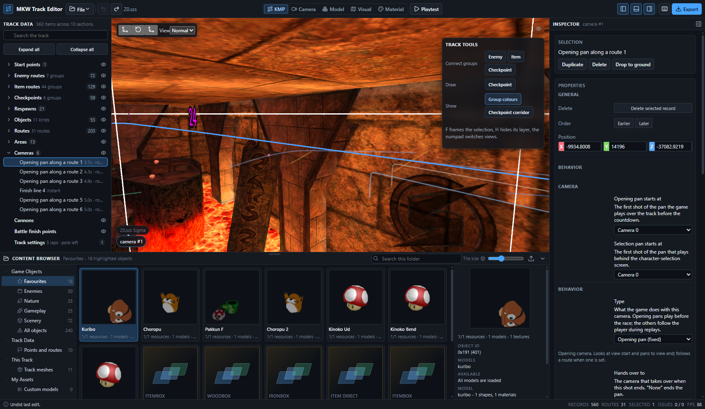

### The outliner

Archives in the order an author thinks about them — course model, skybox, minimap, then object
models alphabetically. An archive is only *listed* once expanded, because listing walks the whole
BRRES; the course model is expanded on entering the mode.

Each material row carries its layer textures as the caption and three badges:

- **Blend** — the material draws in the translucent pass.
- **Shared** — its TEV shader block is shared with other materials, so editing the shader has to
  decide whether to clone the block or rewrite it for everyone. The tooltip names them.
- Two numbers: how many meshes draw with it, and how many TEV stages it has.

The search box matches material names, model names, archive labels, texture names and mesh names.
Hovering a row highlights that material's meshes in the viewport; selecting one highlights them
more strongly and fills the inspector and the graph.

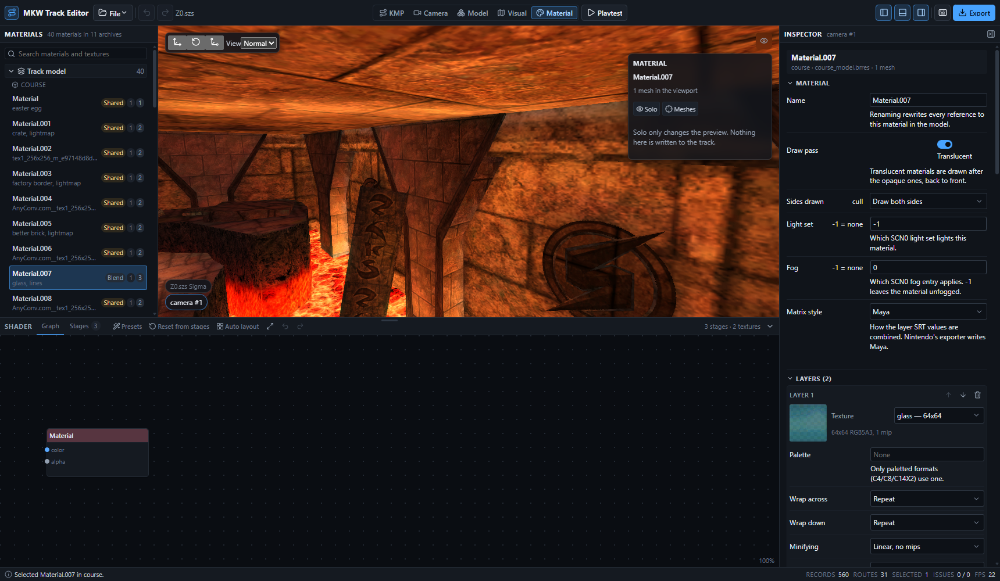

### The inspector

Every control writes a whole new `GxMaterialDoc`; nothing in the inspector knows what a byte is.
Sections, in the order an author works in:

| Section | Fields |
| --- | --- |
| **Material** | Name, draw pass (opaque / translucent), which sides are drawn, SCN0 light set and fog index, texture-matrix style. |
| **Layers** | One card per sampler: texture picker with a thumbnail, palette (and its TLUT slot, for a paletted texture only), wrap S/T, min/mag filter, detail (LOD) bias, sharpening (anisotropy), bias clamp, edge mips, map mode; the SRT (scale / rotation / shift, and the reference camera and light for env modes); the texgen (type, source, matrix, normalize). Add, remove and reorder. |
| **Lighting** | Per channel: material and ambient colour, then for the colour and alpha halves — lit by scene lights, where the base and ambient colour come from, falloff, attenuation, and which of the eight lights the half sees. |
| **Colours** | The three colour registers C0..C2 (s10) and the four constants K0..K3, plus the four swap tables. |
| **Blend & alpha** | Blend mode, source and destination factors, logic operation, the constant-alpha register, and the two-part alpha test. |
| **Depth** | Test, comparison, write, and whether the depth test runs before or after texturing. |
| **Advanced** | Indirect stages and the three indirect matrices, as raw fields. |

Numbers scrub (drag the field, Shift for fine, Ctrl for coarse). A drag is one history entry: the
values during the drag are transient and only its release commits.

Above the sections is a warning strip listing whatever `collectMaterialIssues` reports about the
document right now. It is a strip and not a block on purpose: retail content really does ship
materials whose stage samples a texture slot the material has no layer for, and writing such a
material back unchanged has to keep working. `applyMaterial` only refuses the defects an edit
*introduced*, and returns the rest as warnings.

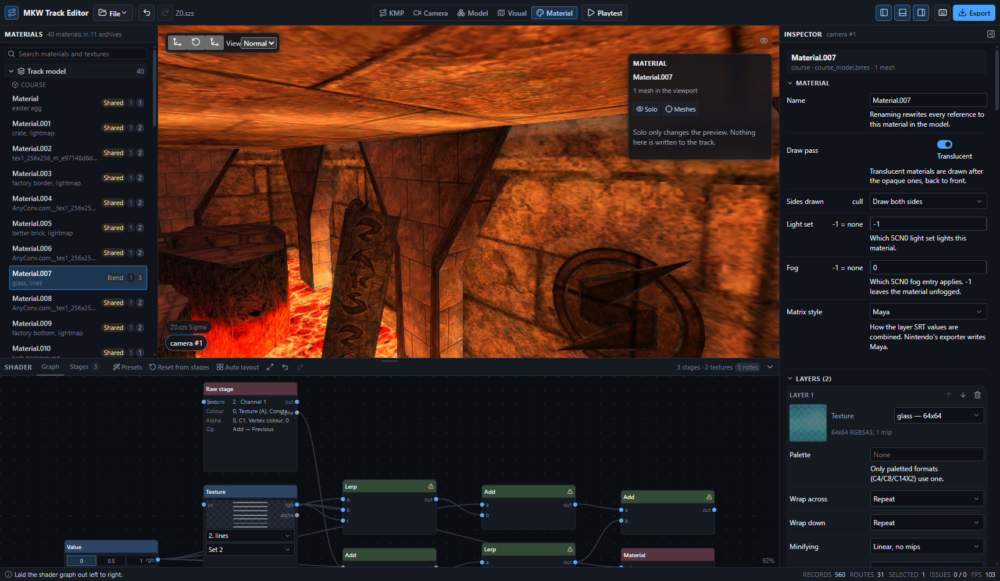

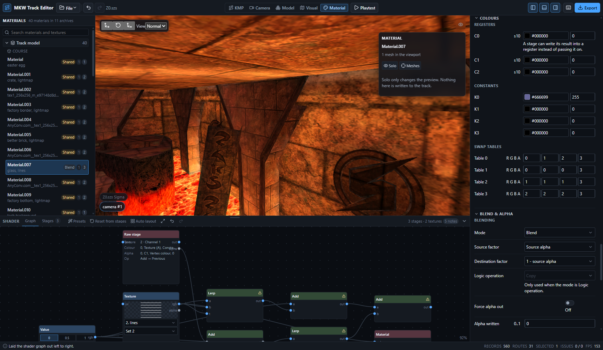

#### Importing a texture

Every layer card takes a PNG, either through **Import PNG…** or by dropping the file on the card.
The card's three controls decide how it is encoded:

- **Format** — CMPR by default (smallest), RGB5A3 when soft alpha matters, RGBA8 for full quality,
  plus the greyscale and 16-bit formats.
- **Size** — powers of two up to 1024.
- **Mip levels** — clamped to what the size allows.

The image is decoded with `readImageFile`, encoded with `encodeTex0Data` (both already used by
Visual mode's texture replacement), added to the archive with `addTexture`, and the layer is
pointed at it. **Export PNG** writes the layer's current texture back out through
`exportTextureAsPng`.

### The shader graph

The graph is the authoring model; TEV stages are the target. Every node maps onto something one
TEV stage can do, so compiling is a lowering pass rather than a search.

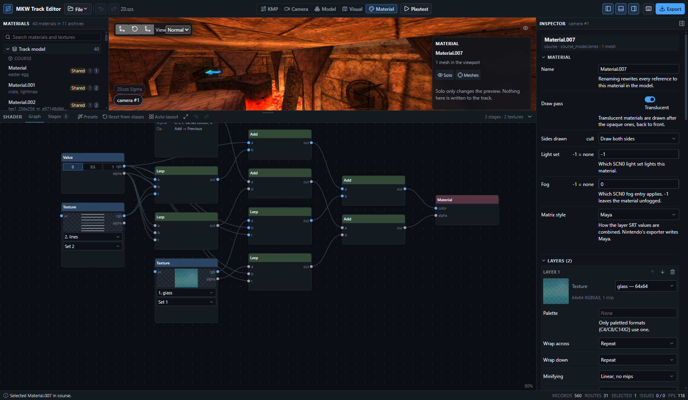

#### The node palette

| Node | What it compiles to |
| --- | --- |
| **Material** | The output. Its `color` and `alpha` inputs are the last stage's result. There is exactly one, and it cannot be deleted or duplicated. |
| **Texture** | Binds a layer and a texture-coordinate set to the stage: `TEXC` / `TEXA`. Shows the layer's thumbnail. |
| **Vertex colour** | The rasterised lighting channel: `RASC` / `RASA`, and sets the stage's channel. |
| **Colour** | One of the konst colours K0..K3 (`KONST`). The swatch edits the material's konst colour, so it previews live. Its **Advanced** block picks the exact selection (`colorSel` / `alphaSel`) for the cases the slot cannot name: the eight hardware fractions and the single-channel reads. |
| **Register** | The starting value of C0, C1 or C2. The swatch edits the material's register. |
| **Value** | The literals 0, 0.5 and 1, which the hardware supplies for free. |
| **Multiply** | `a x b` — one stage, as `lerp(0, a, b)`. |
| **Add** / **Subtract** | `a + b` / `a - b` — the stage's D input plus or minus the rest. |
| **Lerp** | `lerp(a, b, t)` — exactly one whole TEV stage. |
| **Scale** | Multiplies by 0.5 / 1 / 2 / 4 with an optional ±0.5 bias and a clamp. Free on a stage. |
| **Compare** | The TEV compare ops: `(a op b) ? c : 0`, plus `d`. |
| **Indirect warp** | Routes an indirect stage into the texture sampled after it. |
| **Comment** | A resizable note. Never compiles to anything. |
| **Raw stage** | A stage the graph cannot express — a raster alpha read, a non-default swap table, a compare op the `compare` node does not cover. The decompiler emits one instead of guessing and the compiler copies it out verbatim. Read-only, and never in the palette. Its `prev` input carries no value; it only says which stage runs before it, so a chain of raw stages keeps its order. |

Sockets carry either `rgb` or `alpha`; there is no `rgba` wire, because the colour and alpha
pipelines are compiled separately and zipped onto the same stages. The maths nodes are
polymorphic: every socket takes the type of whatever is wired in first, and after that they all
agree. A wire whose types do not match is refused with a shake and a message.

Nodes also carry a `stageTemplate` the decompiler fills in — the fields of a TEV stage the graph
has no opinion about (swap tables, the indirect setup, konst and channel selections a stage names
but never reads). The editor never shows it, but it copies it with the node, so duplicating or
pasting a node keeps the material recompiling exactly.

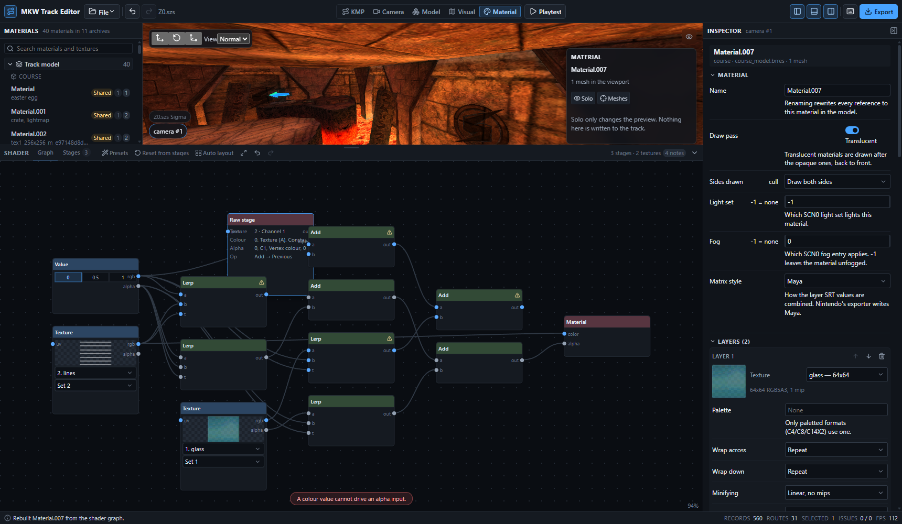

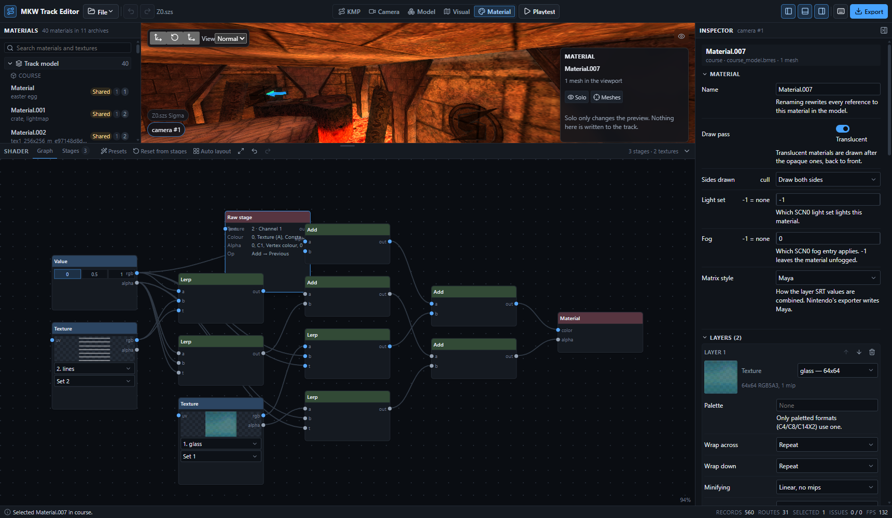

#### Navigating and editing

| Gesture | Effect |
| --- | --- |
| Middle-drag, Space+drag, two-finger scroll | Pan |
| Wheel | Zoom about the cursor, clamped to 0.25x..2x (the readout is in the corner) |
| Fit button | Frame the whole graph |
| Drag a node | Move it; Ctrl snaps to the 8px grid |
| Drag empty space | Marquee-select |
| Shift+click | Add to or remove from the selection |
| Click a wire | Select it |
| Drag output → input | Connect. An input takes one wire, so this replaces whatever fed it |
| Drag a wire onto empty space | Opens the palette filtered to nodes that could legally be wired there, and connects the one picked |
| Double-click or right-click empty space | Open the "Add node" search palette |
| `Delete` | Delete the selected nodes and wires |
| `Ctrl+D` | Duplicate the selection, with the wires inside it |
| `Ctrl+C` / `Ctrl+V` | Copy the selection as JSON / paste it |
| `Ctrl+A` | Select every node |
| `Ctrl+Z` / `Ctrl+Y` | Undo / redo inside the graph (a separate stack from the editor's) |
| `Esc` | Close the palette and clear the selection |

The same list is in the `?` shortcut sheet (`EDITOR_SHORTCUTS`, "Shader graph").

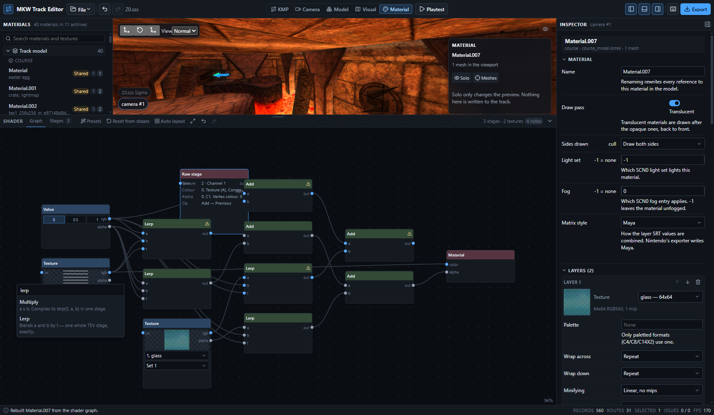

The toolbar has a **Presets** menu (`SHADER_GRAPH_PRESETS`), **Reset from stages** (re-runs
`decompileShader`), **Auto layout**, fit, and the graph's own undo/redo.

Applying a preset does more than swap the graph. It also tops the material's layers up to the
preset's `samplerCount`, and — for the presets in `PRESET_WANTS_LIGHTING` — turns lighting on for
channel 0, which is material state the graph has no way to express.

**Auto layout** is left-to-right and "as late as possible": a node's column is set by how far it
still is from the Material node, so a texture feeding the last stage sits beside that stage rather
than back at the far left with every other source. A freshly decompiled graph is laid out this way
before it is shown, because the decompiler orders nodes by stage but does not know how tall this
editor draws them.

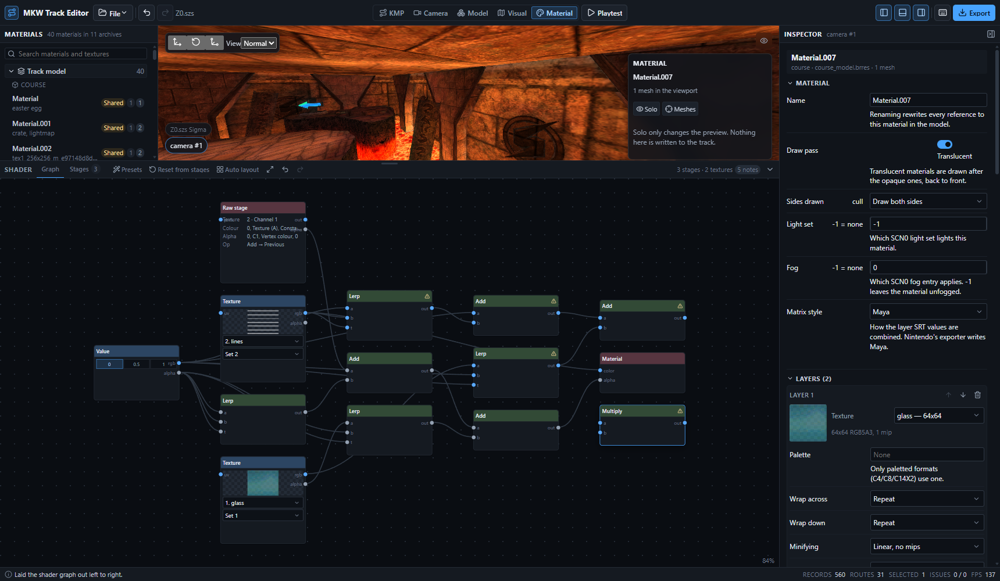

#### Compiling

The graph is compiled on every change, debounced by 50 ms. When it compiles, the stages go into
the material through `withCompiledShader` and are written back like any other edit. When it does
not, the material keeps the last stages that did and the status line says why. Diagnostics appear
as badges on the nodes and edges they are about, with the message in a tooltip.

The status line on the right of the dock header is the honest one: it reports the stages the
material *actually has*. A freshly decompiled graph is a view of the material's existing stages,
so its compile is only a round trip and is not written back — the graph only becomes what gets
written once it has been edited.

#### The Stages tab

A read-only table of exactly what will be written: per stage, the texture, coordinate set,
channel and konst selections, and both the colour and alpha halves' four inputs, op, bias, scale,
clamp and output register. Every value is named in plain language (`Vertex colour (RGB)`, not
`RASC`), which is also what the unit tests assert.

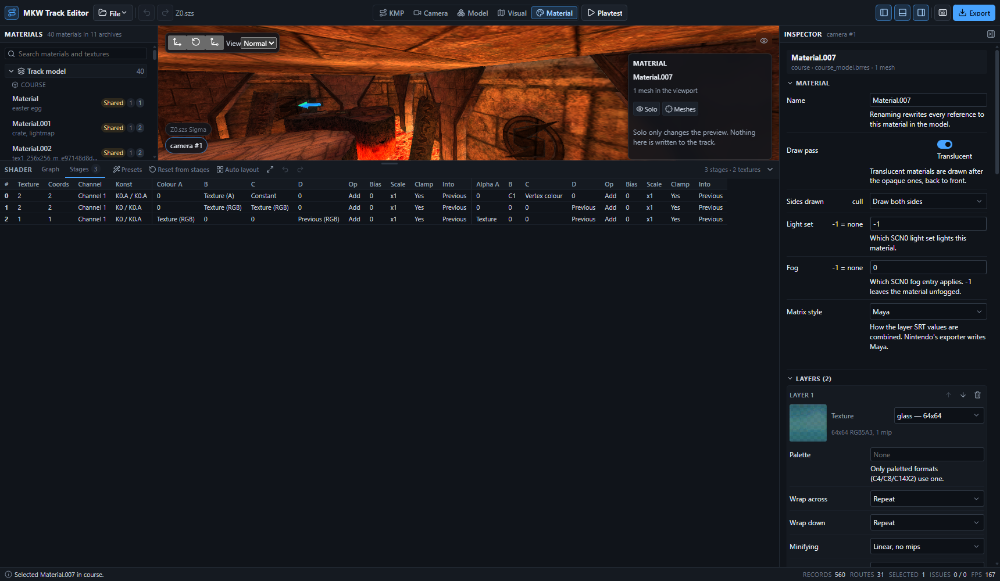

### Where the graph is stored

A graph is a *view* of a material's stages: the same stages can be drawn as many different node
arrangements and only the author knows which one they meant. So each material's graph is kept:

1. **for the session** in a map in the mode hook, keyed by
   `<archive>|<model>|<material>` (`sessionGraphKey`), and
2. **across sessions** in IndexedDB, in its own database `mkw-track-editor-shader-graphs`, under
   `graph:<archivePath>:<model>:<material>:<hash of tevStages>` (`graphStorageKey`).

The stage hash is an FNV-1a over every field of every stage that the compiler writes, so a stored
graph is only ever re-used while it still describes the material's actual stages. If the stages
changed underneath it — the material was edited elsewhere, or the track was rebuilt — the key no
longer matches and the editor falls back to a fresh `decompileShader`.

It is a separate database rather than a store inside `mkw-track-editor` on purpose: adding a store
means bumping that database's version, and `src/lib/persistedCommon.ts` opens it at version 1,
which would then fail and lose the user's imported `Common.szs`. If IndexedDB is unavailable the
persistence is simply skipped.

### Applying edits, and undo

Every committed edit is one history entry:

1. `applyMaterial(bytes, model, material, doc)` rewrites the archive,
2. the new bytes go into `TrackDocument.archiveEntries` through `replaceArchiveFile`, and into the
   editor history through `history.applyEditorChange` — the same path Visual mode's texture
   replacement uses, so undo and export both see it,
3. the rewritten archive is pushed at the renderer (below),
4. any `warnings` the encoder returns are toasted, once per distinct message — including the
   pre-existing defects it decided to write back rather than refuse.

Continuous drags coalesce: `NumberInput`'s `onChange` marks the edit transient (working document
only) and its `onCommit` — fired once, on release — does the four steps above.

Undo and redo swap the whole `TrackDocument` out from under the mode. Re-decoding the material
from the restored bytes would mean re-parsing a multi-megabyte BRRES on every `Ctrl+Z`, so the
mode keeps a `WeakMap<TrackDocument, docs>` instead and puts the exact document that produced each
version back.

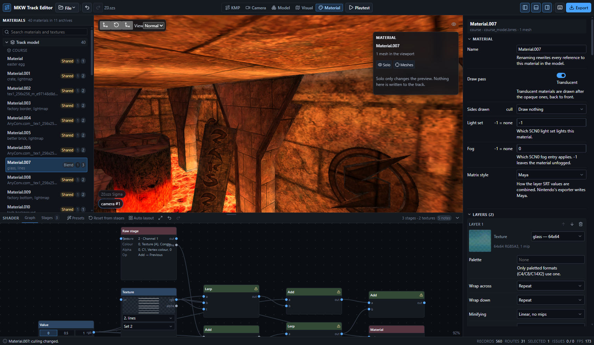

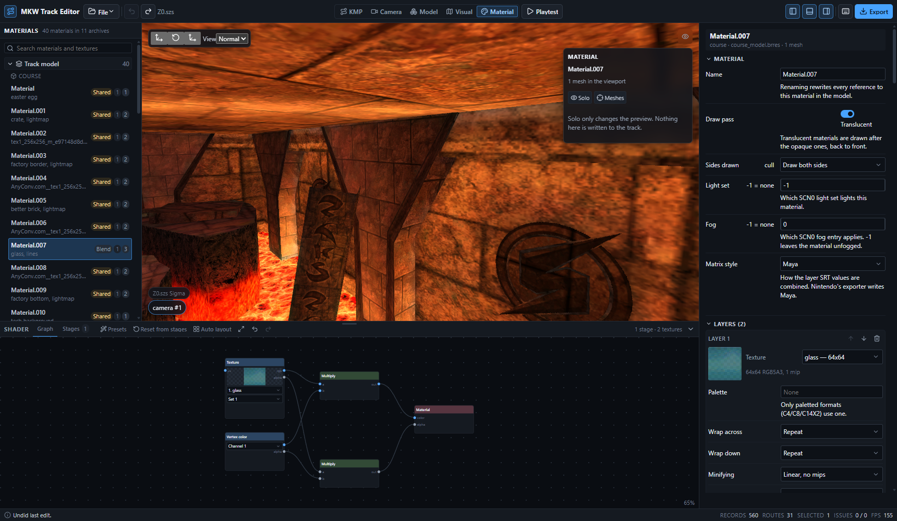

### Live preview

The scene is not rebuilt when a material changes. Instead:

```
MarioKartWiiRenderer.reloadEditorMaterial(archivePath, modelName, materialName, brres) -> boolean
```

- `BRRES.parseMaterialEntry` (added to the vendored `rres/brres.ts`) walks only
  `root` → `3DModels(NW4R)` → the named MDL0's material dictionary and runs the same
  `parseMDL0_MaterialEntry` the full parser uses. No display list, no vertex array, no other
  material is touched, so this is cheap enough to run on every committed edit.
- `MDL0Model.replaceMaterial(device, cache, index, entry)` builds a new `MaterialData` for that
  index and re-binds it to the texture holder (or res file) the model was loaded against.
- `MDL0ModelInstance.replaceMaterial(index)` rebuilds the per-draw-call `MaterialInstance`s for
  that material and repoints the `ShapeInstance`s that drew with the old one, carrying across the
  draw layer, visibility, skinning and fog. A `MaterialInstance` copies the material's
  `GXMaterial` at construction, so editing the MDL0 entry alone changes nothing on screen — the
  instance has to be rebuilt. `materialInstances` is per draw op, not per material, so a material
  used by three shapes has three of them; `materialInstanceMatIds` records which MDL0 material
  each one came from.
- The scene then re-applies the editor's render toggles and the enabled animations to the rebuilt
  instances and refreshes the mesh picker's source list.

Nothing on this path has a `destroy`: `GfxProgram`s and `GfxSampler`s come from the shared
`GfxRenderCache`, which owns and dedupes them, so discarding the old material objects leaks
nothing.

`addEditorTexture(name, texture)` uploads a texture the archive did not have before, so an
imported PNG shows up without reloading; an existing name is routed at `reloadEditorTexture`,
which can only replace pixels at the same size and format.

**Limits.**

- It covers every `MDL0ModelInstance` the scene draws — course models, the skybox, imported
  models, object previews — because it walks `baseObjects` through `getModelInstances`, the same
  walk the fog and lighting toggles use.
- It returns `false`, and the status line says the viewport keeps the old look until the track is
  reloaded, when the scene has not loaded that archive (`map_model.brres` is never rendered), when
  the model or material name is not in the edited bytes, or when the bytes do not parse.
- It does **not** fall back to a scene rebuild. A `sceneKey` bump would be a second, much slower
  path for the same job and would throw away the camera; a `false` return and an honest status
  line is better.
- The `Solo` toggle and the mesh highlight use the per-draw visibility overrides Model mode
  introduced (`setEditorMeshVisible` / `setEditorMeshHighlight`). Leaving the mode clears both.

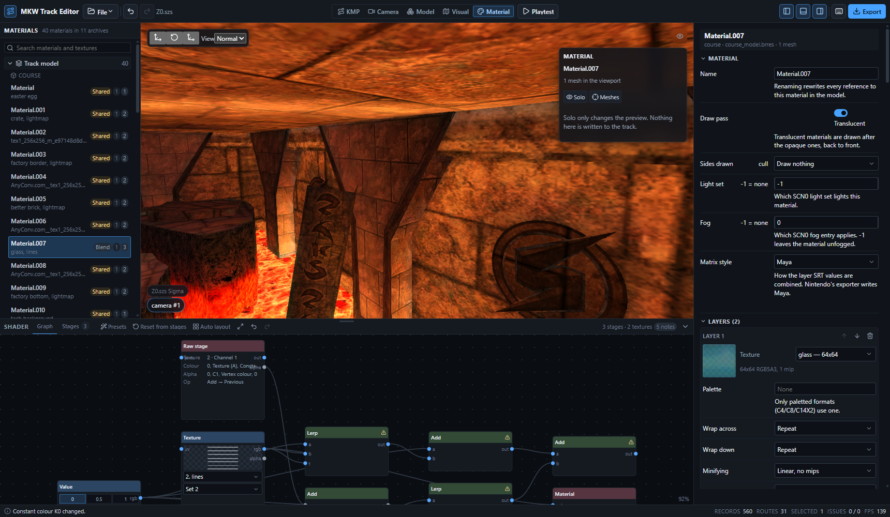

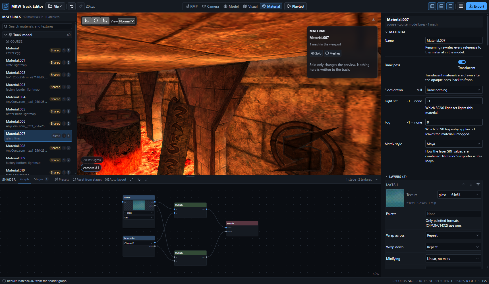

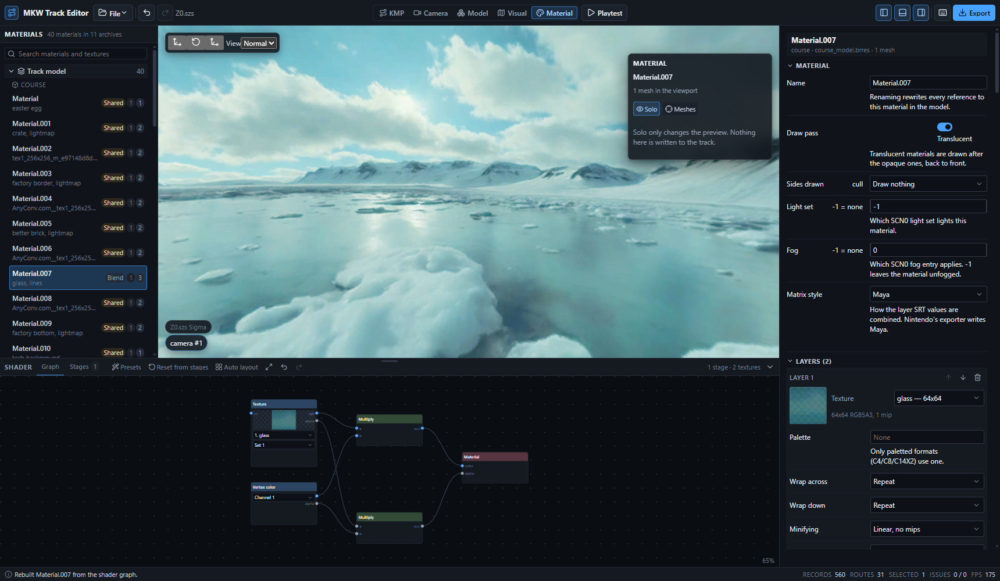

### Tests and the browser probe

Pure logic is unit tested with no DOM (`npm test`):

| File | Covers |
| --- | --- |
| `src/ui/material/graphModel.test.ts` | Node geometry and hit testing, marquee, socket typing and the polymorphic maths nodes, every connection rule (side, self, cycle, type), edge replacement, delete / move / snap / duplicate / copy / paste (including `stageTemplate` surviving both), pan-zoom-fit maths, auto layout, and the raw-stage node's shape. |
| `src/ui/material/materialDoc.test.ts` | Every inspector field → document mapping, colour conversion in both directions, the layer list's add / remove / reorder, the light mask, and the preset's channel-0 lighting. |
| `src/ui/material/materialOutlinerModel.test.ts` | Archive naming and ordering, the tree, the search, the shared-shader badge, reference keys. |
| `src/ui/material/graphStore.test.ts` | The stage hash and both storage keys. |
| `src/ui/material/MaterialInspector.test.tsx` | The inspector, the outliner, the dock's tab state and the stage table, rendered with `renderToStaticMarkup`; includes the assertion that no raw GX enum identifier reaches the user. |

The end-to-end walkthrough is `scripts/probe-material-ui.js`, driven by `scripts/ui-shell-probe.mjs`
against a real Edge window:

```bash
npx vite --host 127.0.0.1 --port 5197 --strictPort
PROBE_PREFIX=material PROBE_PORT=9352 PROBE_SIZE=1720x1000 \
  node scripts/ui-shell-probe.mjs \
  "http://127.0.0.1:5197/?smokeTrack=/dev-tracks/Z0.szs" scripts/probe-material-ui.js
```

It enters the mode, resizes the dock, reads the outliner, searches, selects a material, reads the
graph and the stage table, checks the raw-stage card is read-only, drags a node, connects a wire
and gets one rejected, opens and filters the palette, adds a node, runs auto layout, zooms, opens
every inspector section, edits the culling and a constant colour, applies the lit preset and
checks it turned channel-0 lighting on, solos, undoes back, leaves the mode and reads the stored
graphs out of IndexedDB — reporting every number it saw and writing the screenshots in this
document.

A run on `Z0.szs` at the time of writing: 40 materials in 11 archives, 35 of them sharing a shader
block; the selected material decompiles to 13 nodes and 22 wires including one raw stage, compiles
back to its own 3 stages, and its `Draw nothing` culling edit reaches the viewport through
`reloadEditorMaterial` (the status line says nothing about reloading the track) and comes back on
`Ctrl+Z`.
