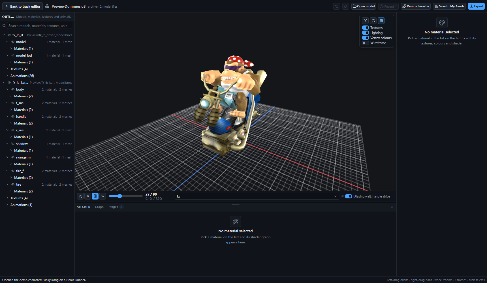
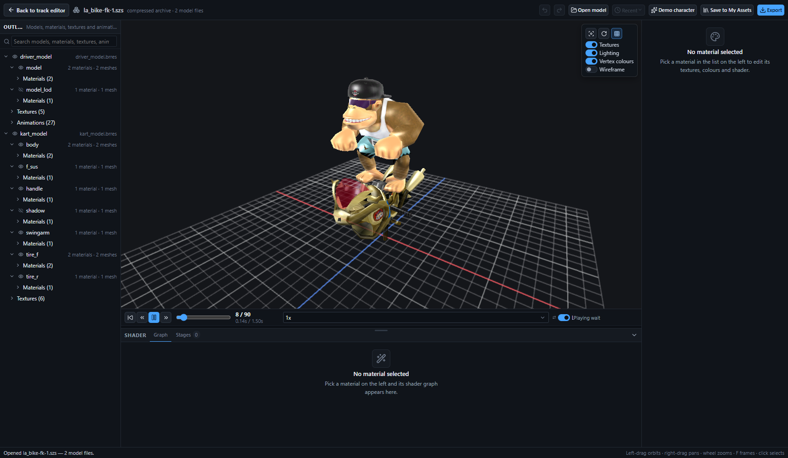
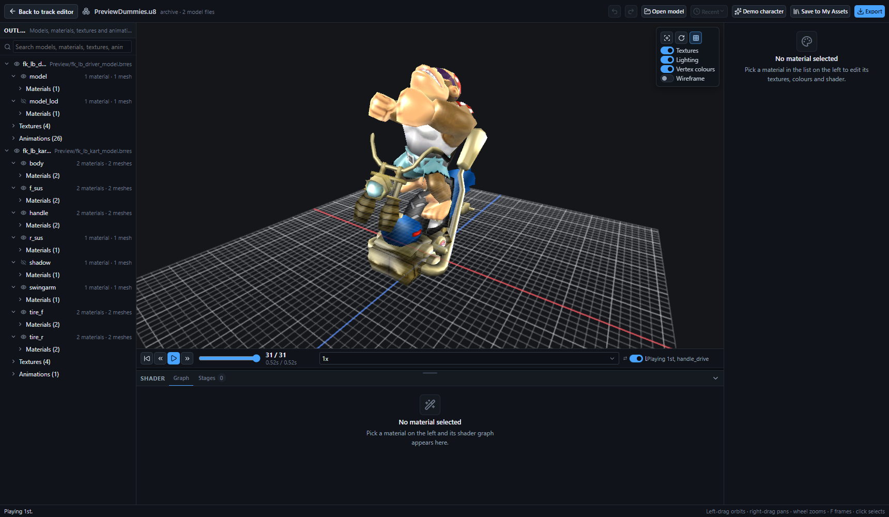
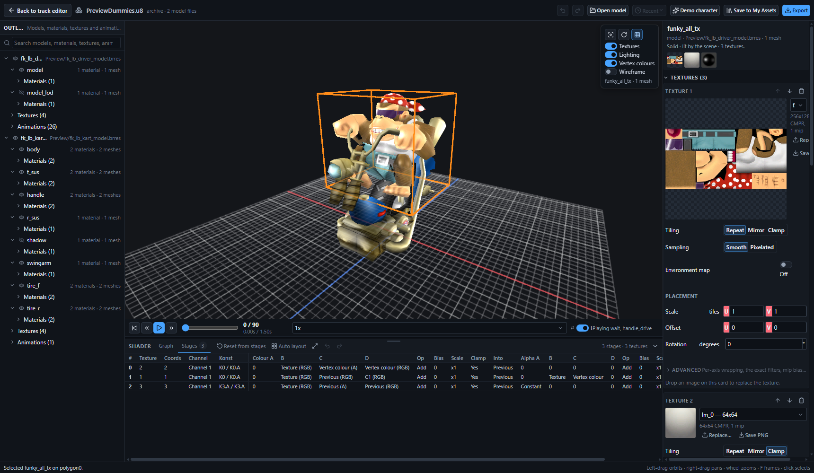
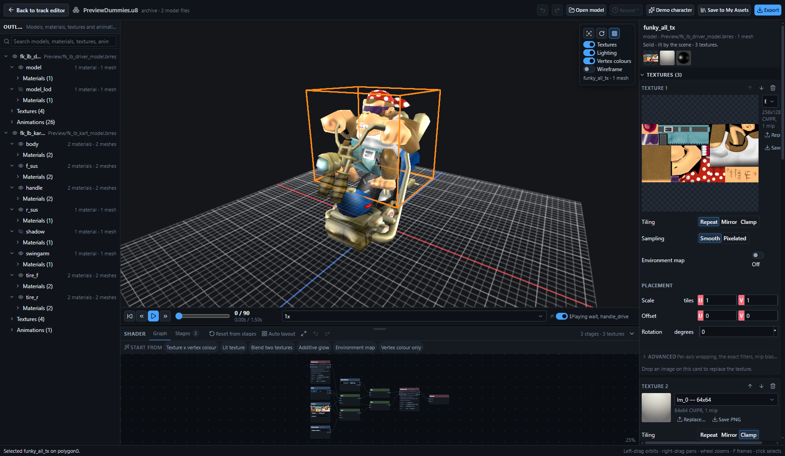
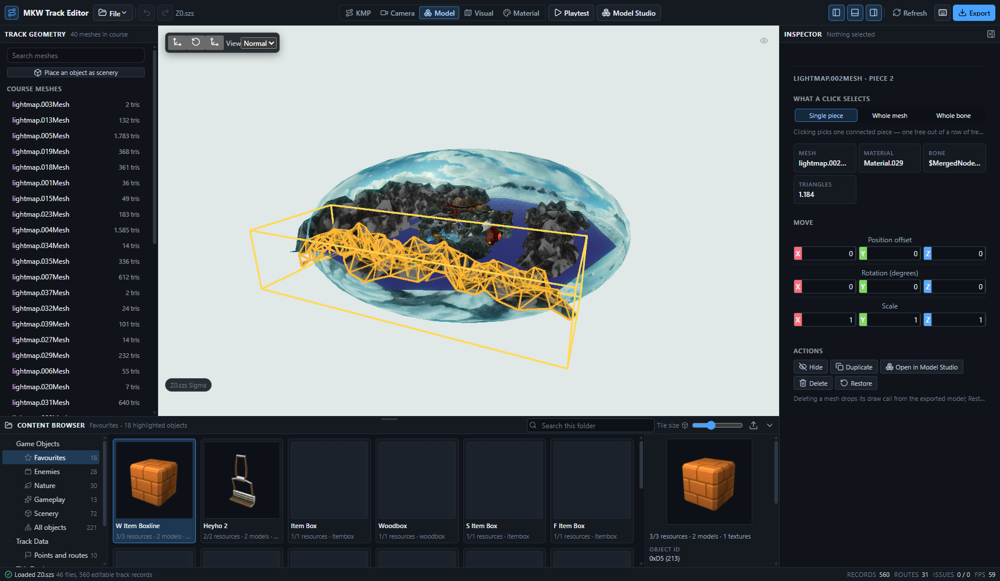
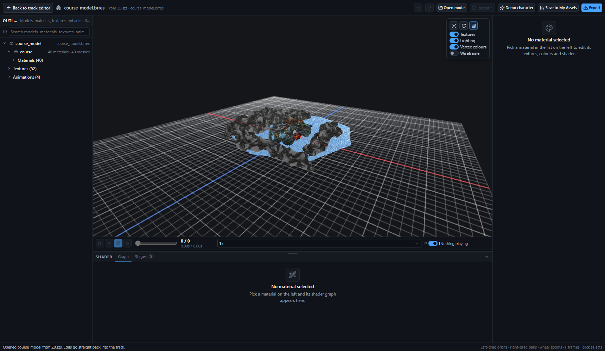
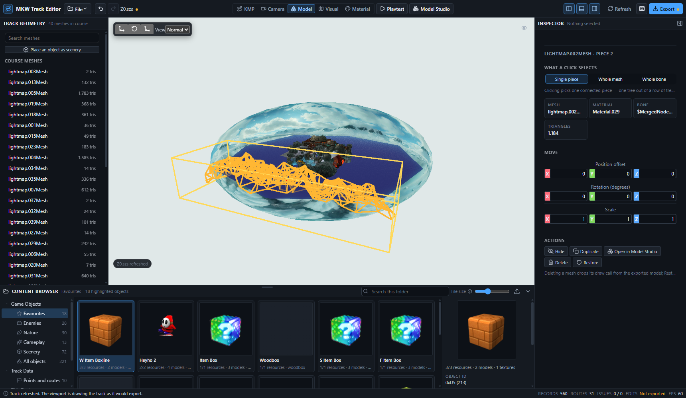
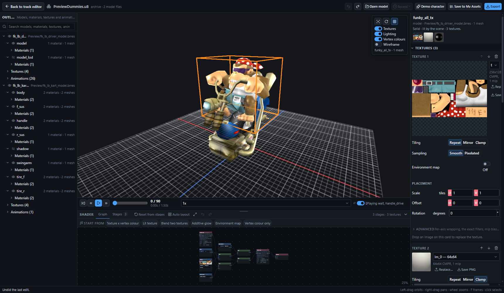
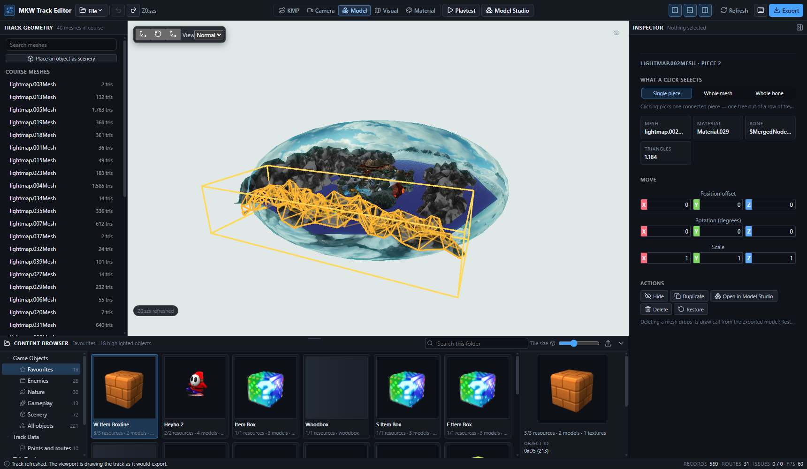

# The Model Studio

A character/model viewer with animation playback and the shader editor, as its own workspace.

Open it from **Model Studio** in the top bar, from **File → Open model in Studio…**, or from the
**Open in Model Studio** action on a selected mesh (Model mode) or material (Material mode). It
fills the window over the track editor and gives it back untouched on `Esc` or **Back to track
editor**. It works with no track loaded at all.



## Why a workspace and not a fifth mode

The five editor modes are five ways of looking at *one track*: they share its viewport, its
camera, its selection and its bottom dock. A character is not part of a track, and looking at one
needs the opposite of a track camera — an orbit around a small object, a ground grid for scale, an
animation transport, and no KMP overlays at all.

That is the same reason Unreal opens a Skeletal Mesh or a Material in its own asset editor
rather than in the level viewport, and the Model Studio is shaped like one: preview viewport in
the middle, asset outliner on the left, details panel on the right, transport under the preview,
and the node graph in the bottom dock.

| Region | What it is |
| --- | --- |
| Header | The open file, undo/redo, **Open model**, **Recent**, **Demo character**, **Save to My Assets**, **Export**, and the way back. |
| Left | `StudioOutliner` — archives → models → materials, plus the archive's textures and animations. |
| Centre | `StudioViewport` (its own canvas, its own noclip `Viewer`), the render toggles, and `StudioTransportBar`. |
| Right | `MaterialInspector` — the same simple-by-default panel Material mode uses, unchanged. |
| Bottom | `ShaderGraphDock` — the same **Graph** / **Stages** dock Material mode uses, unchanged. |

Reusing the inspector and the dock verbatim was possible because both already take a
`GxMaterialDoc` plus a change callback and know nothing about `TrackDocument`; see
[`docs/MATERIALS.md`](MATERIALS.md). What the studio supplies instead of the track is
`useStudioSession`, its own document + undo stack over a `StudioDocument`.

## What it can open

| Source | How |
| --- | --- |
| `.brres` | A bare model archive. |
| `.szs` | A Yaz0-compressed U8 archive. Every `.brres` inside is listed and drawn together, so a character `.szs` shows its driver *and* its kart. |
| `.u8` | The same, uncompressed. |
| Demo character | The bundled `public/data/MarioKartWii/Race/PreviewDummies.u8` — Funky Kong on a Flame Runner — so the studio has content with no setup at all. It is what opens if nothing else was asked for. |
| A track archive | From Model mode or Material mode. Edits are written straight back into the loaded track. |

Files can also be dropped anywhere on the studio. Everything opened by hand goes into **Recent**,
which keeps the bytes in the editor's IndexedDB (`studio-recent`, newest first, at most 8 files
and 48 MB) because a browser cannot reopen a file it was handed once.



## The viewport

`src/ui/studio/StudioViewport.tsx` creates its own canvas, its own `Viewer` via
`initializeViewerWebGL2`, and its own `StudioScene`. It is deliberately not `Noclip3DViewport`:
that component is the track editor's KMP gizmos, collision, drag-and-drop placement, camera
playback and fly camera, none of which applies here. What the two share is everything below the
scene — the same renderer, the same `Viewer`.

| Gesture | Effect |
| --- | --- |
| Left-drag | Orbit |
| Middle-drag, right-drag, or Shift+left-drag | Pan |
| Wheel | Dolly in and out |
| `F`, or the crosshair button | Frame the model, or the selected material's mesh |
| Click | Select the mesh under the cursor; its material fills the inspector and the graph |
| Hover | Outline the mesh under the cursor |

The camera is driven directly (`viewer.cameraController` stays `null`), so **the studio never takes
pointer lock** — an asset viewer that swallows the cursor is not one anybody would use.

The overlay in the corner carries the turntable and grid switches and the four render toggles
(textures, lighting, vertex colours, wireframe), which go to the same scene methods Visual mode
uses.

## The animation transport

Every enabled animation runs on one clock, because that is what the game does: a driver's CHR0 and
its kart's SRT0 play together. The timeline spans the *longest* enabled animation; the transport
has play/pause, step, scrub, a speed (0.1x–4x) and a loop switch, and the readout shows both
frames and seconds.

Which animations are enabled is a per-archive set in the scene, toggled from the play button on
each animation row in the outliner. On load the studio enables what NW4R's naming convention says
belongs to a model (an animation named after an MDL0), plus a character's idle CHR0 (`wait`, else
`body`, else the first) when nothing matched — so a driver stands in its wait pose instead of its
bind pose. SCN0 is listed but greyed: the BRRES renderer has no SCN0 playback.

`MDL0ModelInstance` has no unbind for CHR0 or VIS0, so turning one off rebuilds the instance from
the same already-uploaded `MDL0Model` with only the still-enabled animations on it — the same
trick `Scenes_MarioKartWii.ts` uses for Visual mode.



## The scene contract

`vendor/noclip.website/src/MarioKartWii/StudioScene.ts` is a second, much smaller noclip scene.
`src/ui/studio/studioScene.ts` declares the slice of it the UI drives, structurally, so `src/ui`
never imports a vendored type — the same arrangement as `materialScene.ts` and `visualScene.ts`.

| Method | What it does |
| --- | --- |
| `loadStudioArchive(path, brres)` / `unloadStudioArchive(path)` / `listStudioArchives()` | Parse a BRRES, add every MDL0 as an `MDL0ModelInstance`, and report its models, textures and animations. Re-loading a path replaces it. |
| `setEditorSceneModelVisible`, `setStudioModelVisible` | Per-archive and per-model visibility (the outliner's eyes). |
| `listEditorAnimations`, `setEditorAnimationEnabled` | The animation list and its play toggles. |
| `setStudioTransport`, `setEditorSceneTimeFrames`, `getEditorSceneTimeFrames`, `getStudioAnimationDuration` | The clock. |
| `listEditorMeshes`, `pickEditorMesh`, `setEditorMeshHighlight`, `setEditorMeshVisible` | Picking and highlighting. |
| `reloadEditorMaterial`, `addEditorTexture`, `reloadEditorTexture`, `listEditorTextureNames` | The live material preview, identical in shape to the track scene's. |
| `setEditorTexturesEnabled`, `setEditorVertexColorsEnabled`, `setEditorLightingEnabled`, `setEditorWireframe`, `setStudioGridVisible` | The render toggles. |
| `getStudioBounds`, `getStudioMeshBounds` | What the camera frames. |
| `getStudioPoseSignature` | Diagnostics: a number that changes when the animated pose does. Only the browser probe reads it. |

Two additive hooks were needed below the scene. `MDL0ModelInstance.getCHR0Animator()` in
`vendor/noclip.website/src/rres/render.ts` exposes the bound CHR0 animator, because the studio's
picker has to run the node walk itself; everything else it uses (`replaceMaterial`,
`shapeInstances[i].editorOverride`) was already there for Model and Material mode.

### Picking follows the animation

`EditorMeshPicker` — the track editor's picker — is not reused, for two reasons: it skips skinned
shapes (`shape.mtxIdx < 0`), and a Mario Kart Wii character is almost entirely skinned; and it
builds its geometry from the *bind* pose, so a click on an animated character would hit where the
model was, not where it is.

The studio's picker instead rebuilds world-space triangles from the live joint matrices whenever
the clock has moved since the cache was built (so a paused model costs nothing). A rigid shape
takes its one node matrix; a skinned shape reads the matrix slot packed in the w of each vertex
position and looks it up through the draw's `posMatrixTable` — exactly what the vertex shader does
through `u_PosMtx`.

The hover and selection markers are the draw call's bounding box rather than its wireframe: one
draw call *is* the whole character, and outlining every edge of it hides the thing that was just
selected.

### Two models start hidden

A kart archive's `shadow` MDL0 is the blob the game projects on the ground — on its own it is a
translucent box around the vehicle — and a `*_lod` mesh is the distant stand-in, which sits inside
the real one and z-fights it. Neither is drawn *with* the model on the console, so both start
hidden, with the eye in the outliner one click away.

## The flat dark-blue character, and what it actually was

In the track editor the bundled preview driver renders as a flat dark-blue silhouette. The cause
is the light set, not the shader:

A Mario Kart Wii character material has lighting enabled on colour channel 0 and names a *light
set* (`MDL0_MaterialEntry.lightSetIdx`) that the model does not contain. On the console the light
set comes from the scene's `.blight`. In noclip that is `BRRES.LightSetting`, bound per model
instance; `MaterialInstance.fillMaterialParamsData` then does

```
lightSet.calcLights(...)              // fills u_Lights
lightSet.calcAmbColorCopy(...)        // overwrites AMB0
lightSet.calcLightSetLitMask(...)     // forces channel 0's lighting on, and sets its litMask
```

With **no** `LightSetting` bound, every entry of `u_Lights` stays zero and the channel collapses
to `ambient x material`, which for the retail driver materials is a dark blue. Binding the
*course's* `.blight` — which is what the track scene does, since it binds one light setting to
every object it draws — is no better: its light sets are indexed for course materials, so the
driver's `lightSetIdx` lands on a set with no light objects in it, `calcLightSetLitMask` pins
`litMask` to 0, and the result is the same flat ambient.

That is why `disableVertexColors` and `disableLighting` changed nothing: neither touches the
light-set path. `disableLighting` replaces the channel with its material colour, which for these
materials is the same dark value.

**The fix** is `createStudioLightSetting()` in `StudioScene.ts`: a three-point rig (a warm key
from the front-upper-right, a cool fill from the front-left, a rim from behind) plus a mid-grey
ambient, with **every one of the 128 light sets** pointed at the same three light objects. Whatever
index a material names, it is lit. The lights are point lights parked 10^6 units out — the only
kind `LightSet.calcLights` can place — with unit attenuation (`k0 = 1, k1 = k2 = 0`), so the rig is
exactly as bright as its colours say under every spot and distance function a material may pick.

Measured in the studio with `scripts/probe-studio-open.js`: the brightest 40x40 patch of the demo
character reads `rgb(129, 128, 112)` with a 64/255 spread between channels, against a
`rgb(20, 22, 26)` backdrop. A silhouette would be dark and colourless.

## Editing

Selecting a material — by clicking the model, or from the outliner — fills the inspector and the
shader graph. Every control is the one Material mode uses, so everything in
[`docs/MATERIALS.md`](MATERIALS.md) applies: the simple/advanced split, the node palette, the
presets, the stage table, the graph's own undo stack, the stored graph layouts.





A committed edit does four things:

1. `applyMaterial(bytes, model, material, doc)` rewrites the BRRES,
2. the new bytes replace that file in the `StudioDocument` (`replaceStudioBrres`),
3. `reloadEditorMaterial` hot-swaps the material in the studio viewport, and
4. when the studio was opened from a track, the same bytes go into the track document through
   `replaceArchiveFile` + `history.applyEditorChange`.

Undo is the studio's own stack (`Ctrl+Z` / `Ctrl+Y`), a list of whole `{ document, decoded
materials }` snapshots; restoring one reloads the changed archives into the scene and, for a track
session, commits the restored bytes back to the track too.

## Output

| Action | What it writes |
| --- | --- |
| **Export** | The whole document: the `.brres` for a bare file, or the repacked `.u8` / `.szs` for an archive, Yaz0-compressed again when the source was. |
| **Save to My Assets** | The selected model archive into the content browser's custom model library (`src/lib/assetLibrary.ts`), so a re-shaded model can be dragged into a track. |

**An untouched file exports byte for byte what was opened.** The document keeps the source bytes
and hands them back verbatim until something is actually edited — which is the only way a `.szs`
can round-trip exactly, because Yaz0 is not a canonical encoding and re-compressing produces a
different (equally valid) stream. After an edit the archive is rebuilt from the captured `U8Layout`,
so every file the studio did not touch is still identical byte for byte.
`studioDocument.test.ts` proves both.

## Interaction with the track editor

`ModelInspector` (Model mode) and `MaterialViewOverlay` (Material mode) offer **Open in Model
Studio** for the selected mesh / material's archive. The shell resolves the archive's own path in
the track document — the renderer says `./course_model.brres`, the document says
`course_model.brres`, and `replaceArchiveFile` matches on the document's spelling — and hands the
studio a `StudioTrackBridge` that commits every edit into the track.





On the way back the shell runs the existing **Refresh track** flow (`refreshTrack()`), because a
studio session can change far more than one hot-swappable material and Refresh is the path that
always works. The status line says so: *"Track refreshed. The viewport is drawing the track as it
would export."* The undo history is the track's own, so `Ctrl+Z` in the editor undoes the studio's
edit.



Material mode drops its decoded documents for any archive whose bytes changed under it, so a
material the studio rewrote is re-read the next time it is selected instead of showing the version
from before.

## File map

| File | Responsibility |
| --- | --- |
| `src/ui/studio/ModelStudio.tsx` | The workspace: header, layout, the dock's size, the keyboard, and `window.__mkwStudio`. |
| `src/ui/studio/useStudioSession.ts` | Everything stateful: opening, the material documents, the graph, the transport, the render toggles, undo, and the bridge back to a track. |
| `src/ui/studio/StudioViewport.tsx` | The canvas, the `Viewer`, the orbit camera, picking, and the pixel readback the probes use. |
| `src/ui/studio/StudioOutliner.tsx` | The tree, with an eye on what is drawn and a play button on what moves. |
| `src/ui/studio/StudioTransportBar.tsx` | The transport under the viewport. |
| `src/ui/studio/studioDocument.ts` | What is open: containers, the BRRES list, replacement and export. Pure. |
| `src/ui/studio/studioOutlinerModel.ts` | The tree, the search and the animation summaries. Pure. |
| `src/ui/studio/animationTransport.ts` | The transport's maths and its formatting. Pure. |
| `src/ui/studio/studioScene.ts` | The structural contract for the vendored scene. |
| `src/ui/studio/studioRecent.ts` | Recent files, in IndexedDB. |
| `src/ui/studio/studioLaunch.ts` | The request the rest of the editor makes to open the studio. |
| `src/ui/studio/studio.css` | The workspace's styles, on the tokens in `docs/UI.md`. |
| `vendor/noclip.website/src/MarioKartWii/StudioScene.ts` | The scene: models, the light rig, the grid, the animation clock, picking and the material hot swap. |

## Tests and probes

Pure logic, with no DOM (`npm test`):

| File | Covers |
| --- | --- |
| `studioDocument.test.ts` | Container detection and naming, the archive ordering, the refusal message for a file that is not a model, and both round trips: untouched exports byte-identically (including a Yaz0 `.szs`), and an edited archive still reproduces every other file exactly. |
| `animationTransport.test.ts` | The clock: rate, speed, looping, a one-shot stopping on its last frame, scrubbing, stepping, clamping, both readouts and the "what is playing" line. |
| `studioOutlinerModel.test.ts` | The tree's shape, the visibility and play flags on the right rows, SCN0 marked unplayable, the search across materials/textures/meshes/animations, the default expansion, the timeline length — and that no four-letter section code reaches the user. |
| `studioRecent.test.ts` | Recency: one entry per file, newest first, capped by count and by total size. |

The browser probes drive a real off-screen Edge window through `scripts/studio-probe.mjs`, which
waits on `window.__mkwStudio` rather than on a loaded track so it can run a studio session with no
track at all. Vite's watcher does not see edits inside a git worktree on this host, so restart the
dev server first: `bash scripts/studio-dev-restart.sh 5233`.

```bash
bash scripts/studio-dev-restart.sh 5233

PROBE_PREFIX=studio PROBE_PORT=9433 PROBE_SIZE=1720x1000 \
  node scripts/studio-probe.mjs "http://127.0.0.1:5233/" scripts/probe-studio-open.js

PROBE_PREFIX=studiomat PROBE_PORT=9437 PROBE_SIZE=1720x1000 \
  node scripts/studio-probe.mjs "http://127.0.0.1:5233/" scripts/probe-studio-material.js

PROBE_PREFIX=studiochar PROBE_PORT=9441 PROBE_SIZE=1720x1000 \
  node scripts/studio-probe.mjs "http://127.0.0.1:5233/" scripts/probe-studio-character.js

PROBE_STUDIO_OPEN=track PROBE_PREFIX=studiotrack PROBE_PORT=9442 PROBE_SIZE=1720x1000 \
  node scripts/studio-probe.mjs "http://127.0.0.1:5233/?track=/dev-tracks/Z0.szs" \
  scripts/probe-studio-track.js
```

| Probe | What it proves | A run |
| --- | --- | --- |
| `probe-studio-open.js` | The studio opens from the top bar with no track; the demo character and its bike are lit and textured; the animations are listed; scrubbing and switching CHR0 move the bones. | Brightest patch `rgb(129, 128, 112)`, 64/255 channel spread; 27 CHR0s across the two archives; pose signature 7068.761 at frame 0 → 7058.716 at frame 36 → 9043.313 on another CHR0. |
| `probe-studio-material.js` | Clicking the model selects the material under the cursor; the inspector, the stage table and the graph fill in; two edits reach the picture; undo returns the exact bytes. | `funky_all_tx` on `polygon0`; 5 inspector sections, 3 stage rows, 11 graph nodes; texture swap moves the frame by 8.33/255, "draw nothing" by 36.6/255; after undo the frame is back within 0.02 and the export hash is the untouched one. |
| `probe-studio-character.js` | A real `Character/*.szs` opens, renders and exports byte-identically. | `la_bike-fk-1.szs`: `driver_model.brres` (27 CHR0s) + `kart_model.brres`; brightest patch `rgb(136, 114, 87)`, 49/255 spread; export 229 977 bytes, the same length and hash as the input. |
| `probe-studio-track.js` | Model mode → **Open in Model Studio** → edit → back → the track viewport shows it, and `Ctrl+Z` undoes it. | `course_model.brres` (40 materials) from `Z0.szs`; culling `Material.029` moves 6.8% of the track frame (3.67/255 mean); after undo + Refresh the frame is back within 0.02/255, the noise floor. |




